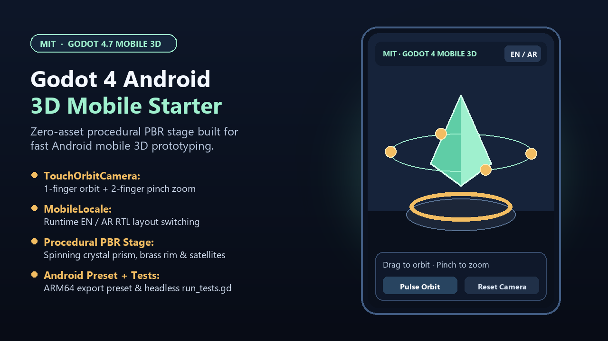

# Godot 4 Android 3D Mobile Starter (MIT)



A minimal, **MIT-licensed**, **Godot 4.7+** mobile 3D starter template demonstrating single-finger touch orbit, two-finger pinch zoom, procedural PBR meshes/materials (`Mobile` renderer + `ETC2/ASTC`), and bilingual **English & Arabic (RTL)** runtime localization — with zero external binary assets or plugins.

## What Is Included
- **`scripts/touch_orbit_camera.gd` (`TouchOrbitCamera`):** Single-finger drag orbit, two-finger pinch zoom, pitch/distance clamping, smooth damping, and desktop mouse drag/wheel preview.
- **`scripts/mobile_locale.gd` (`MobileLocale`) + `localization/strings.json`:** Runtime `TranslationServer` loader with automatic `LAYOUT_DIRECTION_RTL` / `LAYOUT_DIRECTION_LTR` switching between English and Arabic.
- **`scripts/main.gd` + `scenes/main.tscn`:** Procedural 3D crystal & brass pedestal PBR stage (`StandardMaterial3D`, `Mobile` renderer) plus Android hardware back-button handling (`NOTIFICATION_WM_GO_BACK_REQUEST`).
- **`tests/run_tests.gd`:** Headless verification suite checking localization key parity, orbit/zoom clamping, and 3D stage instantiation.
- **`export_presets.cfg`:** Preconfigured ARM64 Android preset (edge-to-edge enabled, zero `INTERNET` permission).

## Run Headless Verification & Export Android Debug APK

Tested on **Godot 4.7.2-stable**:

```bash
# 1. Import project resources
godot --headless --path . --import

# 2. Run headless verification suite
godot --headless --path . --script res://tests/run_tests.gd

# 3. Export Android debug APK (requires Godot Android export templates installed)
godot --headless --path . --export-debug "Android" release/Godot4Android3DStarter-debug.apk
```

Download the prebuilt debug APK from **[Releases](https://github.com/simple-free-apps/godot4-android-3d-starter/releases)**.

---

## Full Commercial Godot 4 Android 3D Games (Codester)

If you want complete multi-level, Google Play-ready Godot 4 Android 3D games with full level packs, audio, AdMob integration, and bilingual EN/AR UI:

| Game | Highlights | Store Links |
|---|---|---|
| **Orvaleth: Clockwork Spires** | 60 3D clockwork contraption levels across 4 worlds + 5×5 level workshop + EN/AR | **[Codester · $14](https://www.codester.com/items/76144/orvaleth-godot-3d-clockwork-puzzle-game?ref=Gr8Man)** · [Google Play Demo](https://play.google.com/store/apps/details?id=com.valkora.serenth.orvaleth) |
| **Veyravel: Rift Courier** | 3D Android hovercraft action roguelite across 36 floating sectors + upgrades | **[Codester · $14](https://www.codester.com/items/76079/veyravel-3d-android-action-game-godot?ref=Gr8Man)** |
| **Full Gr8 Studio Catalog** | 10 Android & Godot source kits & live browser puzzle demos | **[simple-free-apps.github.io](https://simple-free-apps.github.io/?utm_source=godot_assetlib&utm_medium=readme&utm_campaign=catalog)** |

*Disclosure: Codester links include the publisher's `?ref=Gr8Man` referral code.*

## License
Distributed under the [MIT License](LICENSE).
